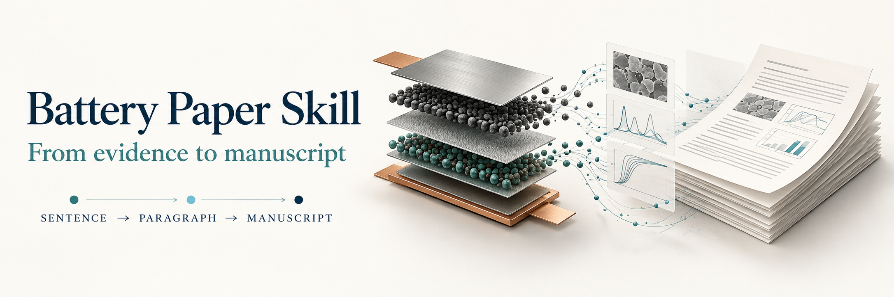
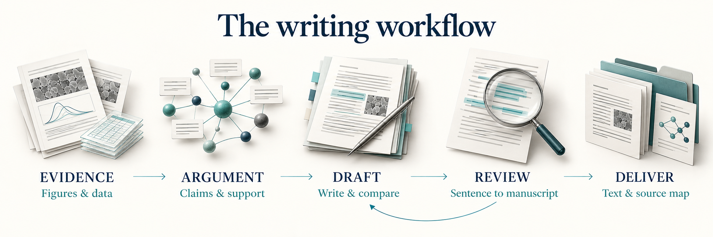
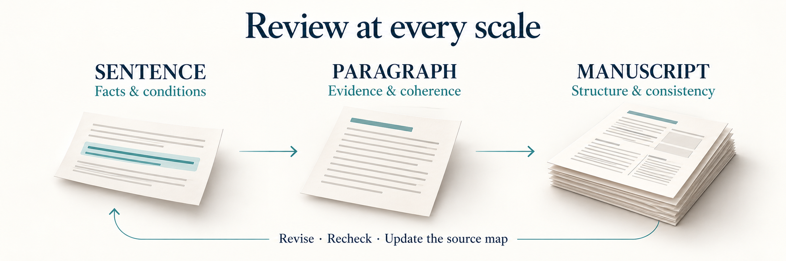

  

**从图与数据出发，构建有证据、有逻辑、可追溯的电池论文。**

[安装与使用](#安装与使用) · [写作流程](#写作流程) · [论文语料库](#论文语料库) · [验证记录](#验证记录)

---

**Battery Paper Skill** 是面向电池论文的 Agent Skill，覆盖论证规划、逐图写作、表征描述、中英重构和全文审查。从作者提供的图、数据和已有稿件出发，按任务选读真实论文原文，保留已经确认的结构和表达。

适用于电池材料、界面、电解液、固态体系、电极工程、器件与计算。仓库以 `SKILL.md` 为入口；不同智能体的安装方法与支持范围见下文。

## 核心能力

| 工作环节 | 关注重点 | 交付内容 |
| :--- | :--- | :--- |
| **论证规划** | 科学问题、有限主张、关键证据与适用边界 | 图间关系、图内逻辑、段落顺序 |
| **分层写作** | 论文部分的职责、段落推进、句子重心 | 按当前任务选用的写法与完整改写示例 |
| **表征写作** | 直接观察、峰归属与拟合、模型和解释 | 条件明确、判断强度匹配证据的描述 |
| **原文对照** | 真实论文的表达方式与段落组织 | 来源定位、中文含义、本稿表达与改写说明 |
| **中英重构** | 材料状态、物理量、比较方向与限定 | 连贯正文、必要中文释义、独立图注 |
| **三级审查** | 逐句核据、每段即时复核、完成稿宏观审查 | 实质修改、复查记录、更新后的逐句映射 |
| **项目接续** | 确认稿、候选稿、作者取舍与锁定范围 | 可接续的项目记录与一致的最终交付 |

## 安装与使用

### 跨智能体快速安装

已安装 Node.js **22.20 或更高版本**时，可使用 Vercel 的 [Skills CLI](https://github.com/vercel-labs/skills)：

~~~bash
npx skills add 1234jian-fu/battery-paper-skill --skill battery-paper-skill
~~~

交互选择目标智能体，默认安装到当前项目；加 `-g` 可安装到用户范围。也可以用 `-a` 指定智能体，例如：

~~~bash
# Codex
npx skills add 1234jian-fu/battery-paper-skill --skill battery-paper-skill -a codex

# Claude Code
npx skills add 1234jian-fu/battery-paper-skill --skill battery-paper-skill -a claude-code
~~~

这是可选的第三方安装工具。无需 Node.js 的手动安装方法及其他平台命令见 [完整安装指南](docs/installation.md)。

### 按智能体安装

下表中的目录是存放 `battery-paper-skill/` 的父目录；安装时保留仓库内的相对路径。

| 智能体 | 项目级目录 | 用户级目录 | 详细方法 |
| :--- | :--- | :--- | :--- |
| **Codex** | `.agents/skills/` | `~/.agents/skills/` | [安装与旧路径兼容](docs/installation.md#codex) |
| **Claude Code** | `.claude/skills/` | `~/.claude/skills/` | [安装与调用](docs/installation.md#claude-code) |
| **Cursor** | `.cursor/skills/` | `~/.cursor/skills/` | [安装与发现](docs/installation.md#cursor) |
| **Gemini CLI** | `.gemini/skills/` | `~/.gemini/skills/` | [原生命令安装](docs/installation.md#gemini-cli) |
| **GitHub Copilot CLI** | `.github/skills/` | `~/.copilot/skills/` | [安装与重载](docs/installation.md#github-copilot) |
| **OpenCode** | `.opencode/skills/` | `~/.config/opencode/skills/` | [安装与权限](docs/installation.md#opencode) |

安装说明依据各平台官方文档核对。当前本机已安装 Codex 版本；其他平台为文档与目录兼容性核对，**未逐平台完成真实写作验收**。已有 Codex 安装器使用的 `~/.codex/skills/` 路径另在指南中说明。

### 开始写作

准备当前稿、图与图注、必要的数据或方法说明，告诉智能体本次处理范围和需要保留的内容：

~~~text
使用 battery-paper-skill。
先读取我的当前稿和图，保留已确认结构，一幅图一幅图写。
先给图间、图内逻辑及逐句来源映射，再给正文和图注。
每段写完后对照实际核读的同功能论文段落，修改后再继续。
~~~

Codex 中可用 `$battery-paper-skill` 显式调用；其他平台的调用入口见 [安装指南](docs/installation.md)。

<strong>更多示例：表征表达、局部英文修改与全文复审</strong>

**表征表达**

~~~text
使用 battery-paper-skill 检查这段表征描述。
对照真实原始研究，区分直接观察、峰归属、模型与解释。
保留测试条件和证据边界，指出并修改过强的机理判断。
~~~

**局部英文修改**

~~~text
使用 battery-paper-skill 修改这一段英文，只处理当前段落。
保留全部数据、条件、比较方向和判断强度，只输出修改后的正文。
~~~

**完成稿宏观复审**

~~~text
使用 battery-paper-skill 审查这份完整稿件。
先从实际正文反提主线与章节关系，再对照已核读高水平论文的组织方式。
检查摘要、引言、结果和结论是否一致；提出结构调整后再修改正文。
~~~

> **按任务范围执行。** 新稿或实质重构默认按整篇累计至少 **60 篇滚动近五年相关原始研究**；单句纠错、局部翻译等任务只处理当前范围。通用语料库不自动替代项目专属文献基底。

## 写作流程

先确定科学问题和证据关系，再组织文字；写作、审查与来源映射相互衔接。

<strong>查看中文流程与修改回路</strong>

~~~mermaid
flowchart LR
    A["作者材料 图 · 数据 · 当前稿"] --> B["论证规划 问题 · 主张 · 证据"]
    B --> C["原文对照 相关来源 · 定位 · 边界"]
    C --> D["逐段写作 逐句核据 · 段后复核"]
    D --> E["完成稿审查 主线 · 章节 · 一致性"]
    E --> F["最终交付 映射 · 总结 · 正文"]
    E -. "实质修改与复查" .-> D

    classDef input fill:#F1F5F9,stroke:#94A3B8,color:#172B4D
    classDef process fill:#EFF6FF,stroke:#54769C,color:#172B4D
    classDef review fill:#ECFDF5,stroke:#0F766E,color:#115E59
    class A input
    class B,C,D process
    class E,F review
~~~

### 句子 → 段落 → 文章

写作指南将原文中的组织动作落实到三个层面，按任务选读：

| 写作层面 | 具体解决什么 | 指南 |
| :--- | :--- | :--- |
| **论文部分** | 标题、摘要、引言、结果、讨论、结论、方法、图注与SI怎样取舍同一组信息 | [分部写作](references/section-writing.md) |
| **段落** | 怎样围绕一个认识组织现象、对照、解释与验证，接住上一段并推进下一步 | [段落写法](references/paragraph-craft.md) |
| **句子** | 怎样选择主语和动作、安排比较与数值、拆合信息并形成明确落点 | [句子写法](references/sentence-craft.md) |

指南包含真实来源定位与明确标为合成的改写示例。借鉴信息组织，用作者自己的结果写作；不规定统一句数、段数或所谓“顶刊句型”。

三级审查分别解决事实准确、段内论证和全文结构的问题。**段落复核在每段写完后立即进行**，全文审查在当前完整稿形成后进行。

| 层级 | 审查问题 | 修改闭环 |
| :--- | :--- | :--- |
| **句子** | 事实、条件、比较方向和判断强度是否准确？来源是否可定位？ | 修正表达，核对命题与证据 |
| **段落** | 主信息是否明确？证据顺序是否合理？与真实同功能段落相比缺什么？ | 对照原文与上下文，实际修改本段，再复查 |
| **文章** | 科学问题是否贯穿全文？图段是否递进？各章节的主张是否一致？ | 反提全文提纲，对照论文组织方式，调整结构并复审 |

<strong>查看三级审查的复查路径</strong>

~~~mermaid
flowchart LR
    S["句级核据"] --> P["每段即时对照与修改"] --> M["完成稿宏观复审"]
    M --> R["更新正文与逐句映射"]
    P -. "复查受影响句子" .-> S
    R -. "复查受影响段落" .-> P

    classDef level fill:#F8FAFC,stroke:#54769C,color:#172B4D
    classDef final fill:#ECFDF5,stroke:#0F766E,color:#115E59
    class S,P,M level
    class R final
~~~

默认交付顺序为 **报表包 → 简短逻辑总结 → 干净正文**。图注任务另附图注并分别计数。若只需要正文，可直接指定；相关核查仍按任务范围执行。

逐句映射区分机理解释 **M**、技术描述与证据 **T**、衔接组织 **L**，记录原文英文、中文含义、本稿表达及改写边界。最终句表与实际交付正文保持一致。详见 [交付约定](references/output-contract.md)。

## 论文语料库

**51 篇已核读原始研究 · 目标 1000 篇 · 按写作任务选读**

<table>
  <tr>
    <td align="center" width="33%">
       
      <strong>Nature</strong> 7 篇
    </td>
    <td align="center" width="33%">
       
      <strong>Nature Energy</strong> 10 篇
    </td>
    <td align="center" width="33%">
       
      <strong>Nature Communications</strong> 18 篇
    </td>
  </tr>
  <tr>
    <td align="center">
       
      <strong>Advanced Materials</strong> 6 篇
    </td>
    <td align="center">
       
      <strong>Advanced Energy Materials</strong> 10 篇
    </td>
    <td align="center">
      <strong>51 篇来源</strong>  
      逐篇定位 · 组织分析 表达示范 · 证据边界
    </td>
  </tr>
</table>

期刊标识用于说明语料来源，不代表合作或背书。[视觉资源来源](assets/README.md)。

每篇卡片记录论文身份、版本、来源入口、实际阅读位置、可借鉴的写作动作和不可迁移的事实边界。**51 篇均有相关正文阅读记录，其中 19 篇另有主文组织通览**；具体核读范围逐篇声明。

[浏览语料索引 →](references/literature-corpus.md) · [按任务检索 →](docs/corpus-catalog.md) · [查看升级记录 →](docs/upgrades.md)

语料逐步扩充至 **1000 篇**，每批将真实阅读中的发现落实到写作规则、段落与全文审查，并用实际写作场景回归。维护目标为每天新增200篇，只有完成核验及相关正文阅读的来源才计数；正文与可取得的补充材料一同归档。详见[持续扩库与能力评测](docs/corpus-growth.md)。

全文 PDF 与相关资料独立归档到本地资料库。仓库提供索引和阅读卡，不包含论文全文、论文原图或用户实验数据；表达示范来源不自动进入本稿的正式参考文献。首页封面与流程配图均为 AI 生成的概念插画。

## 结构与扩展

入口保持简洁，专业规则和论文卡按当前任务选读。完整执行流程单独维护，便于逐图写作与项目接续。

| 入口 | 用途 |
| :--- | :--- |
| [SKILL.md](SKILL.md) | 任务选择、写作主线、证据底线与交付 |
| [论证设计](references/argument-design.md) | 写前规划：科学问题、主张证据、图段顺序 |
| [审查协议](references/review-protocol.md) | 写后复核：句子、每段即时对照、全文宏观审查 |
| [表征表达](references/characterization-writing.md) | 测试条件、信号解释与证据层级 |
| [英文重构](references/english-workflow.md) | 信息组织、表达自然度与保义 |
| [执行流程](references/workflow.md) | 完整 S01–S12 与交接职责 |

<strong>展开完整目录</strong>

~~~text
battery-paper-skill/
├── SKILL.md                         技能入口
├── agents/openai.yaml               显示名称与默认提示
├── assets/                          README 视觉资源与来源说明
├── references/
│   ├── argument-design.md           写前论证规划
│   ├── review-protocol.md           句子—段落—文章审查
│   ├── characterization-writing.md  表征表达与证据层级
│   ├── english-workflow.md          英文重构与保义
│   ├── literature-corpus.md         真实论文分页索引
│   ├── corpus/                      逐篇阅读卡
│   ├── workflow.md                  S01–S12 完整流程
│   ├── field-routing.md             电池体系与研究部件
│   ├── battery-language-library.md  常见测试语言动作
│   ├── recent-corpus-policy.md      项目文献基底与资格检查
│   ├── context-and-mappings.md      项目记录与接续
│   ├── output-contract.md           逐句映射与交付约定
│   └── skill-integration.md         规则分工与可选集成
├── scripts/paper_workbench.py       本地辅助检查
├── tests/                           合成测试
├── evals/                           写作对照与表达审读记录
└── docs/                            安装、设计、数据格式与验证范围
~~~

<strong>展开辅助命令与运行说明</strong>

辅助脚本只使用 Python 标准库。下列命令从 Skill 根目录执行；其他目录下请使用加引号的脚本绝对路径。

`PROJECT` 为已存在的论文项目目录，`AS_OF` 为客户端日期或作者指定截止日，格式为 `YYYY-MM-DD`。其余大写项替换为实际名称、领域、关键词或文件路径。

~~~text
python scripts/paper_workbench.py init --project-dir PROJECT --name NAME --domain DOMAIN
python scripts/paper_workbench.py status --project-dir PROJECT
python scripts/paper_workbench.py sources --project-dir PROJECT --query "KEYWORDS" --as-of AS_OF
python scripts/paper_workbench.py corpus --project-dir PROJECT --as-of AS_OF
python scripts/paper_workbench.py count --file DRAFT
python scripts/paper_workbench.py check --project-dir PROJECT
python scripts/paper_workbench.py delivery-check --project-dir PROJECT --file DELIVERY_JSON
python -X utf8 -m unittest discover -s tests -p "test_*.py" -v
~~~

所有辅助命令均不联网。`sources` 仅筛选项目已有的 `sources.json`，不搜索、下载论文或自动建立文献库；实际检索和核读依赖当前环境可用工具。

初始化只补缺，不覆盖已有记录。缺少明确作者变更依据的旧政策会报告为 `needs_policy_update`；自定数量或时窗须记录作者决定，脚本分别报告默认与实际有效政策。

完整参数与示例见 [辅助工具说明](docs/helper-schema-and-tests.md)，也可使用各命令的 `--help`。

## 验证记录

| 记录 | 已完成范围 | 解释边界 |
| :--- | :--- | :--- |
| [辅助脚本测试](docs/helper-test-summary.json) | 59 项测试通过 | 合成测试，检查工具行为 |
| [真实论文写作对照](evals/real-paper/README.md) | 2 个案例 × 3 组，共 6 份有效正文；两位独立模型评审盲评 | 局部开发案例，不代表完整稿件或未见样本表现 |
| [英文表达审读](evals/style-audit/README.md) | 34 句复核与改写示范 | 非盲编辑审读，未替换原对照分数 |
| [首次语料与结构核查](docs/corpus-expansion.md) | 当时20篇来源的记录、阅读卡与规则分工复查 | 历史批次，当前数量以语料目录为准 |
| [持续升级](docs/upgrades.md) | 可检索目录、按批次规则升级与实际写作回归 | 科学阅读、脚本测试与写作回归分别记录 |
| [分部与句段写作对照](evals/writing-craft/README.md) | 同一合成研究的两版片段、编辑对照与一次续改 | 非盲开发案例，首次输出和后续修订分别保留 |

<strong>展开评测方法与适用范围</strong>

历史写作对照核读两篇论文的相关主文、方法、图注与实图，比较无技能、上游原版和优化版。最初 6 次文件读取运行因环境策略失败被排除；6 份有效输出采用显式文本注入，不代表验证了自动触发或按需读取文件。

三组均保留关键事实与证据边界。优化版在固态案例的论证连接上表现较好；锌案例接近评分上限，并存在局部可读性分歧。每组每案仅运行一次，尚无未见样本泛化、完整真实稿件端到端或多轮自动触发验证。

另根据 Nature 与 Advanced Materials 原始研究完成非盲表达审读，强化信息落点、主题连接与限定去重。这些记录不证明稳定达到目标期刊发表水准。

更多记录：[验证范围](docs/validation.md) · [逻辑审查与修复](docs/logic-audit.md) · [设计与规则分工](references/skill-integration.md) · [扩库与评测计划](docs/corpus-growth.md)。

## 使用边界

- **证据优先。** 保留本研究的材料状态、测试条件和适用限制；记录完整、数字守恒或句表一致不能替代科学判断。
- **阅读范围透明。** 获取、格式验证和实际阅读分别记录。文献全文及 SI 保存到作者指定或空间充足的资料库，项目只记录路径与来源。
- **按需集成。** Nature、ARS、SciPilot、humanizer 等技能可用时按任务调用，不要求全部安装；缺失时使用内置适用规则并说明范围。
- **评价分开。** 语言风格、科学贡献和期刊接收分别判断；不承诺顶刊录用或 AI 检测结果。通用结构示意为自拟，测试夹具为合成材料。

## 致谢与参考

README 的安装入口与文档组织参考 [Anthropic Skills](https://github.com/anthropics/skills) 和 [Vercel Skills](https://github.com/vercel-labs/skills)，安装细节以 [各平台官方文档](docs/installation.md#官方来源) 为准。相关项目和期刊名称归各自权利人所有。

---

**让每一句有依据，让每一段有任务，让整篇论文有主线。**

[技能入口](SKILL.md) · [语料索引](references/literature-corpus.md) · [审查协议](references/review-protocol.md)

